

# 運用AI技術判別精細動作之早期遲緩篩檢系統

**專案名稱：** AI-based_Early_Screening_System_for_Fine_Motor_Developmental_Delay_Identification  
**系統簡稱：** FMAS（妙妙屋 AI 精細動作篩檢系統）  
**團隊名稱：** 現在發現還不遲，你說對不隊(獵遲小隊)  
**團隊成員：** 洪偉城、林政維、呂昊宸、林宛瑩  
**指導教授：** 趙一平教授

## 介紹影片

[運用AI技術判別精細動作之早期遲緩篩檢系統介紹影片](https://youtu.be/uQO-JEKr7U0?si=VP1qGB04YD8S2ogn)

## 獲得的獎項

- [114年度「為桃園做研究」桃園市政府大專校院學生創新點子及研究實作競賽 金質研究獎](https://sccdc.tycg.gov.tw/News_Content.aspx?n=16792&s=1600221#lg=1&slide=1)
- [2025 全國 AI 專題創意競賽 佳作](https://phpweb2.nutn.edu.tw/ilt/wordpress/wp-content/uploads/2025/12/%E6%B1%BA%E8%B3%BD%E7%B5%90%E6%9E%9C.pdf)
- [智創未來：2026生成式AI創意設計競賽 銅牌獎](picture/智創未來：2026生成式AI創意設計競賽.png)

## 目前投稿

- [GCBME 2026 論文稿](doc/GCBME2026_draft_final.pdf)

## 團隊分工

- [獵遲小隊分工表](doc/獵遲小隊分工.pdf)

## 特色一覽

- 標準化評估：基於 PDMS-2 專業量表
- 遊戲化體驗：故事情境降低兒童測試抗拒
- AI 多階段判讀：結合 YOLO、SAM、TensorFlow 與幾何分析，自動化評分減輕人力負擔
- 可攜式設計：五分鐘快速架設，適合偏鄉巡迴
- 自架雲端記錄：完整追蹤兒童發展歷程
- 遠距複核：在地人員操作，治療師從雲端後台遠端複核
- 個資保護：四級權限、去識別化儲存、加密傳輸

## 海報

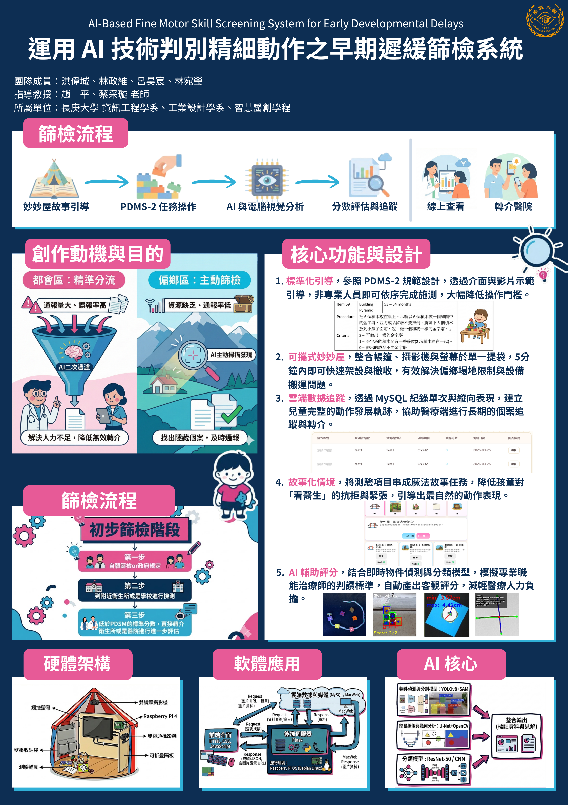

---

## 目錄

1. [主題說明](#主題說明)
2. [設計理念](#設計理念)
3. [作品特色](#作品特色)
4. [架構說明](#架構說明)
5. [AI 應用與模型流程](#ai-應用與模型流程)
6. [AI 生成建議系統（RAG）](#ai-生成建議系統rag)
7. [實作邏輯](#實作邏輯)
8. [使用情境](#使用情境)
9. [商業模式](#商業模式)
10. [競爭分析](#競爭分析)
11. [預期成果](#預期成果)
12. [安裝與使用指南](#安裝與使用指南)
13. [開發工具及相關說明](#開發工具及相關說明)
14. [參考資料](#參考資料)

## 主題說明

### 什麼是兒童發展遲緩？

根據 Guralnick[1] 的觀點，兒童發展遲緩通常來自多重因素，包括生物性風險（例如先天性疾病或神經發展問題）與環境性風險，使兒童在社交、動作或認知發展上落後於同齡。依據美國疾病管制與預防中心[2] 的說明，早期療育（Early Intervention, EI）是指為發展遲緩或身心障礙的嬰幼兒及其家庭提供的服務與支持，可能包括語言治療、物理治療，以及依孩子與家庭需求安排的其他協助。由於幼兒發展具有高度可塑性，及早發現與介入能在黃金時期發揮最大療效，幫助兒童改善功能表現並促進家庭互動。

### 為什麼需要提早介入？

6 歲前是兒童發展的黃金時期。根據統計，110 年底早期療育個案中，以「3～5 歲未滿」者占比 42.3% 為最高，其次「5～6 歲未滿」占 23.4%，兩者合計達 66%。另外，「6 歲以上」者仍占 12.9%。若與性別交叉分析，男童「6 歲以上」占 13.7%，比女童的 11.2% 高出 2.4 個百分點；相對地，男童「0～3 歲未滿」占比 19.8%，比女童的 24.9% 低了 5 個百分點。這些數據顯示，多數孩子是在 3～6 歲才被發現問題，意味著很多兒童已經錯過了最早期的介入時機。

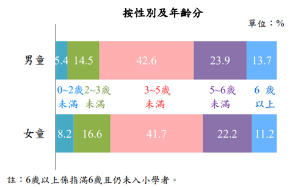

**圖一、110 年底早期療育人數占比[3]**

兒童發展遲緩若能在黃金治療期及早發現並介入，能夠顯著提升康復與學習適應的機會。例如，Hennigan 等人[4]的研究顯示，在學齡前兒童中，經過八週由職能治療師主導的精細動作介入後，精細動作遲緩的比例從 85.7% 降至僅 7%，可見早期介入確實有效。然而，偏鄉地區常因醫療與教育資源不足，問題不容易被及時發現。Barnard-Brak 等人[5]的研究顯示，來自偏鄉或少數族群的家庭更容易因醫療回應延遲，導致發展遲緩的診斷平均延後約 5 個月，增加了錯過早期療育黃金期的風險。同樣地，Hsieh 等人[6]針對台灣偏鄉的研究也指出，當地早期療育資源明顯不足，交通不便與人力缺乏使得兒童難以及時接受專業評估與介入。因此，偏鄉需要一套低門檻、可攜、容易操作的檢測系統，協助第一線人員更早發現兒童的精細動作遲緩，避免延誤治療。

需求與評估量能之間的落差也正在擴大。以桃園市為例，發展遲緩通報率已從 108 年的 12.2% 攀升至 112 年的 14.2%[13]，遠超世界衛生組織 6～8% 的標準，但聯合評估等待時間仍長達 4～6 個月[14]。即便家長主動通報，個案從通報到取得正式聯合評估報告，常需等待半年至一年以上；在這段「聯評空窗期」中，孩子很可能已經錯過 3～6 歲最關鍵的介入時機。

### 系統設計目的

此計畫希望設計一套簡單又方便攜帶的精細動作測驗工具，用來評估兒童是否有發育遲緩。系統規劃放在偏鄉衛生所巡迴使用，讓偏鄉兒童也能接受測試，及早發現潛在問題並接受治療。偏鄉的老師和家長平時已經很忙，身邊又沒有職能治療師可以協助，很難及早察覺小朋友手部精細動作落後，常常等到問題明顯了才注意到，那時已經錯過黃金治療期。
目前國際上最常被使用的兒童動作早期評量工具是皮巴迪動作發展量表第二版（Peabody Developmental Motor Scales 2nd edition，簡稱 PDMS-2）。這個量表適用於 0～7 歲兒童，施測方式標準化，可以把粗動作與精細動作分開評估，每個年齡層都有足夠的題目，結果也能以不同方式呈現，而且對障礙兒童也適用，是一個相當有影響力的工具。不過 PDMS-2 需要專業治療師施測與判讀，對偏鄉老師或家長來說門檻太高，因此本系統把它轉化成簡單、故事化的版本，讓偏鄉衛生所也能施測。
系統會記錄孩子完成每項任務的表現，讓老師和家長更快判斷孩子是否在某些精細動作上需要關注；必要時，衛生所人員可以儘快把孩子轉介到醫院或治療單位，降低因環境限制而錯過早期介入的風險。

### 為什麼選擇 PDMS-2 量表當標準？

Rebelo 等人(2021)[7] 以 392 名 12 至 48 個月大的兒童進行驗證研究，結果顯示 PDMS-2 的內部一致性良好（α = 0.85），代表測驗項目能清楚反映小朋友動作能力的好壞；重測信度也非常高（ICC = 0.98～0.99），同一個小朋友反覆施測，結果幾乎一致。這兩點說明 PDMS-2 能穩定區分兒童的粗大與精細動作是否有遲緩徵兆，適合用在臨床與教育現場。

### 系統的重要性

根據衛福部[8] 的新聞報導，政府自 2024 年 7 月起針對未滿 7 歲兒童新增 6 次兒童發展篩檢服務，透過標準化工具進行檢測與評估。篩檢次數增加之後，第一線對標準化、容易執行的篩檢工具需求也會跟著增加，這正是本系統要補上的缺口。

## 設計理念

依據世界衛生組織 (WHO) 的統計，0 ～ 6 歲兒童發展遲緩的發生率大約是 7%。以台灣來說，每年大約有 20 萬個新生兒出生，換算下來，每年大約會有 1.4 萬名小朋友在六歲前可能出現某些發展遲緩的情況，包含認知、粗細動作、語言溝通、心理社會發展，甚至生活自理等各方面。這個數字其實不小，也顯示出「早期發現、早期協助」的重要性。
偏鄉的醫療資源也明顯不足。根據衛福部國民健康署發布的評估中心名單，評估中心幾乎都聚集在西半部（如圖二所示），整個東半部只有四、五家左右；就算在北部，評估中心也明顯集中在都市（如圖三所示）。從這兩張圖可以看出偏鄉醫療資源的缺乏。

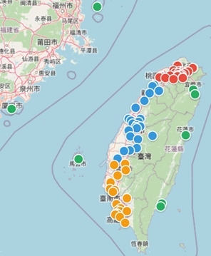

**圖二、評估中心在台灣整體的分布圖[9]**

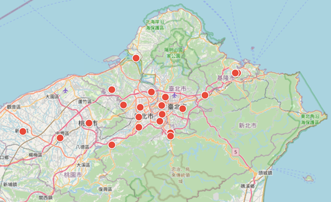

**圖三、評估中心在台灣北部區域的分布圖[9]**

除了人力不足外，醫療機構的數量也嚴重不足。偏鄉及離島地區的醫療機構數量大約只占全國的 6% (如圖四所示)，分布密度相當低，有些鄉鎮甚至只能仰賴少數診所，甚至完全沒有醫療機構。這樣的情況，讓偏鄉兒童能夠獲得專業檢測與協助的機會大幅下降。

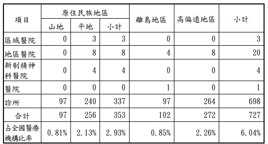

**圖四、107 年度原住民族、離島及高偏遠地區各類醫療機構數統計[10]**

更值得注意的是，發展遲緩兒童的早期療育服務需求正逐年攀升。根據統計，台灣接受早期療育服務的兒童人數自 2016 年的 34,450 人次一路上升，到 2024 年已突破 61,000 人次（如圖五所示）。需要早療的孩子越來越多。

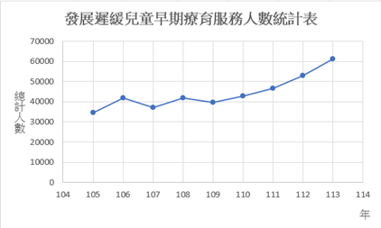

**圖五、發展遲緩兒童早期療育服務人數統計表[11]**

根據 Choo 等人[12]的研究，兒童發展遲緩的早期辨識通常仰賴例行性檢測，或是父母、老師的觀察；但在偏鄉，基層醫師難以全面監測，家長與老師也缺乏足夠的專業判斷。偏鄉老師很難隨時請到職能治療師，如果能把常見的檢測方法轉換成簡單的小工具，老師就能更早察覺孩子的問題並及時轉介，縮小城鄉之間的落差。
另外，本系統強調 「把測驗變成遊戲，把檢測變成故事」，提升投入、數據自然、降低測試效應。小朋友天生愛玩，醫療人員如果直接叫他們做一些手部測驗，小朋友可能會不耐煩或拒絕。但如果把測驗藏在故事裡，讓小朋友覺得自己是在冒險、在幫故事角色完成任務，就會玩得很投入。這樣一來，不僅整個過程變得輕鬆，小朋友也能在自然的狀態下完成動作，收集到的數據也會更準確，對老師和家長來說也更有參考價值。

## 作品特色

影像辨識技術已經相當成熟。系統結合影像辨識與 AI 模型，即使旁邊的人沒有專業背景（不一定是職能治療師），也能完成辨識與評分。搭配妙妙屋環境，系統有以下特點：

### 1. 標準化引導，無需專業背景

依介面指示與示範影片完成全流程，降低施測門檻
以往在操作 PDMS-2 量表的測量時，都需要有職能治療師在旁邊輔助，但職治師的人數有限，且不是每個衛生所都有職治師。本系統依 PDMS-2 評估標準設計流程，提供標準化引導，只要照著介面指示和示範影片一步步操作，就能完成整個測驗。

### 2. 一袋帶走，五分鐘完成

可組裝隔板、雙鏡頭攝影機、觸控螢幕與光源燈條，快速佈撤
除了職治師分配不均，也不是每個衛生所都有適合小朋友施測的環境。妙妙屋採拱形可組裝隔板結構，光源、鏡頭、觸控螢幕與測驗墊都整合在裡面（細節見[實體妙妙屋](#1-實體妙妙屋)）。架設和收拾不到五分鐘，全部東西一個提袋就能帶走，解決偏鄉復健教具搬運困難的問題。

### 3. 雲端留痕，持續追蹤

MySQL 紀錄單次與縱向表現，便於後續轉介與追蹤
早期療育通常需要多次回診與復健，如果每位小朋友的歷次紀錄都留在系統裡，後續追蹤會方便很多。每次活動結束後，系統會把各項評分、總分與影像連結寫回資料庫，在不同裝置上都能開啟查閱（部署方式見[實作邏輯](#實作邏輯)）。

### 4. 故事化任務，降低抗拒

以情境任務隱藏測驗，提升參與與自然表現
在傳統看診時，很多孩童常常聽到自己要去看醫生，或一進到門診教室，就會大哭或是想要離開。本系統結合故事書的方法，將每個測試項目，串成一整個連貫的故事，小朋友在測試時，就宛如在幫故事書中的魔法師解決問題。當然，評估的結果也不會讓小朋友知道。目前 17 項任務都已配好專屬的語音口白與情境動畫，小朋友不需要大人一步步講解，也能聽懂每一關要做什麼。

### 5. AI 輔助評分，減輕人力

以 YOLO 物件偵測、SAM 分割、TensorFlow 分類與幾何規則判斷組成多階段流程
系統依照不同關卡把影像任務拆成多個步驟，不靠單一模型黑箱判斷：先由 YOLO 找出積木、紙張或豆子等目標，再視題型用 SAM 切出精準區域，接著交給 TensorFlow 分類模型或幾何規則判斷，最後轉成分數與標註影像（各關卡做法見[AI 應用與模型流程](#ai-應用與模型流程)）。分數來自輪廓距離、線段端點這類幾何量測，而不是模型的信心分數，治療師可以回頭檢查每個分數是怎麼算出來的。這樣比較貼近 PDMS-2 的評分方式，也減少人工逐張判讀的負擔；之後要加新題型，也能沿用同一套分析架構。

### 6. 模組化擴充

先支援 3～6 歲 17 項目，後續擴大年齡與題組
此系統目前完成 17 個 PDMS-2 精細動作項目（Ch1 疊積木 4 項、Ch2 圖形描繪 6 項、Ch3 剪紙 4 項、Ch4 摺紙 2 項、Ch5 豆豆裝罐 1 項），適用年齡範圍為 3～6 歲，還可以再擴增適用範圍與測試項目數量；除了支援衛生所做巡迴使用，也可以引進到幼兒園，供幼稚園老師做使用，以便提早發現病狀，盡早接受治療。

### 7. 遠距複核，醫療人力智慧調度

在地人員操作，治療師遠端複核
篩檢流程標準化之後，可以交給教保員、社工等非醫療人員執行。治療師不必親自到場，在雲端後台就能查看數據並複核，省下往返偏鄉的交通時間，把心力留給確診與治療。

## 架構說明

系統是主從式（Client-Server）架構，分成邊緣感知、視覺量化、知識檢索決策、雲端回饋四層。前端只要一般文書筆電加上雙鏡頭攝影機擷取影像，AI 運算都在後端伺服器，偏鄉據點不需要準備高階電腦。系統包含以下五個部分：

### 1. 實體妙妙屋

本系統把測驗空間設計成故事情境「妙妙屋」，取代傳統制式的測驗。妙妙屋最初的構想是帳篷式的可攜結構，目前已與學校工業設計系合作，改版為拱形可組裝隔板結構（圖六）：內建光源燈條確保影像辨識品質，俯視與側面雙鏡頭攝影機負責影像擷取，觸控螢幕播放故事情境並提供操作介面，並搭配統一施測環境的測驗墊。前端介面包裝成「歡迎來到童話王國」的遊戲化闖關系統，小朋友登入後就像進入童話王國探險，跟著任務引導一關一關完成測驗。

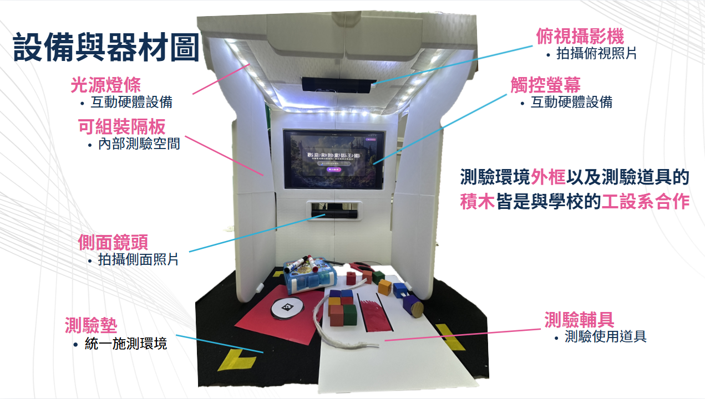

**圖六、設備與器材圖**

### 2. 測驗道具與平台

測驗道具依照 PDMS-2 量表教具的規格製作，例如圖形大小、線寬與積木尺寸。測驗環境外框與積木教具皆與學校工業設計系協作設計製作。測驗的平台會使用自架互動網站，嵌入到觸控螢幕讓小朋友作互動使用。

### 3. 分析系統

後端以 AI 分析小朋友的操作表現，依 PDMS-2 的評分標準判斷是否達到同齡孩子的水準。以下以堆金字塔項目為例，見圖七、圖八、圖九。

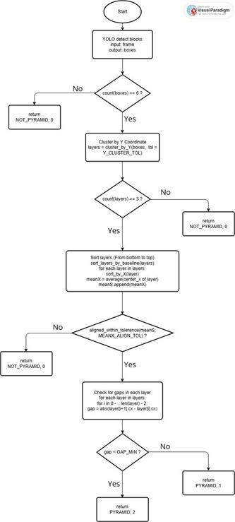

**圖七、堆金字塔程式流程圖**

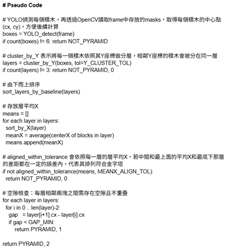

**圖八、堆金字塔程式流程圖 Pseudo Code**

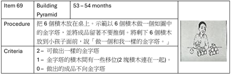

**圖九、PDMS-2 堆金字塔標準圖**

### 4. 回饋系統

系統把結果用簡單明瞭的方式呈現給老師或家長，讓他們依評分標準判斷小朋友是否需要進一步評估或治療，產出家長版與專業版報告範本（短版指標、長版歷程）。使用者依權限分為四級：兒童（受測者）、家長（管理者等級 1，僅能查看自家孩童結果）、施測人員（管理者等級 2，執行測驗與查看評分）、管理者／醫護（管理者等級 3，管理帳號、查詢紀錄與匯出報表）。

### 5. 個資保護與資安機制

家長在施測前要先完成知情同意流程並簽署同意書。測驗影像與評分資料以去識別化方式儲存，只用匿名 UID 對應兒童，分析用的資料集不存放可辨識個人身分的資訊。

密碼經 bcrypt 雜湊後才存進資料庫；家長帳號綁定孩童 UID，只看得到自己孩子的資料。前後端之間透過 Tailscale（WireGuard 協定）加密傳輸，存取權限依前述四級分級控管，資料庫每日自動備份並保留異地副本，避免單一機器故障就遺失資料。

## AI 應用與模型流程

本專案依題型把 AI 拆成多條可重用的視覺流程：

- **Ch1 積木建構題：** 以 YOLO 偵測積木位置，再用 SAM 取得精準遮罩，配合骨架化與層級分組，判斷金字塔、階梯與牆面堆疊是否符合標準。
- **Ch2 圖形描繪題：** 先做 A4 紙校正與像素/公分換算，再透過 YOLO 切出待辨識圖形，搭配 TensorFlow 分類模型區分圓形、橢圓、四邊形、十字等目標，並以骨架與端點分析評分。
- **Ch3 剪紙題：** 以 YOLO 偵測紙張與物件遮罩，再利用 ArUco 標記完成尺度校正，最後根據輪廓到中心點的最短/最長距離計算是否達標。
- **Ch4 摺紙題：** 以彩色邊緣與最大面積四邊形偵測為主，搭配幾何量測與影像分析判定折線與紙張形狀。
- **Ch5 豆豆裝罐題：** 17 項任務中只有這一項另外接了感測器。Arduino 搭配荷重元（load cell）即時計算數量與時間，確認小朋友是一次放一顆，再結合遊戲狀態紀錄做即時回饋與最終評分。其餘 16 項都只靠影像判讀。

這些流程共同的設計原則是「先偵測、再分割、後分類、最後用規則或量測轉成分數」，使模型結果更接近臨床或教學情境下的人工判讀方式。偵測模型採用 YOLOv8／YOLO11，分割模型採用 SAM2／SAM3。

### 生成式 AI 資料擴增

由於實際場域的訓練影像取得不易，除了傳統的旋轉、平移等資料擴增技術外，系統也採用 Gemini Pro 依提示詞生成不同拍攝視角、拍攝光線、擺放形狀與場景的合成訓練照片。經比對，有資料擴增輔助後，模型能更準確辨識積木的顏色與幾何形狀，在背景複雜的情況下仍能穩定找到目標物件，提升各項目的辨識穩定性。

### 技術驗證與實測數據

系統已產出可運作之完整原型（硬體場域＋AI 模型＋雲端資料庫＋前後台介面），目前的模擬測試數據包括：

- 兩點連線任務：以形態學影像運算達成 89% 偵測準確率
- 手繪圓形任務：微調後的 ResNet-50 分類模型達成 95.8% 辨識準確率

目前正在一家衛福部指定的早療服務醫院與合作幼兒園收案，由職能治療師人工判讀結果圖，再和系統評分逐項比對，確認兩者是否一致（系統規格要求各項目準確率達 85% 以上）。收到的資料也會用來繼續訓練 YOLO、SAM 與分類模型，讓模型換了場地也能穩定辨識。

## AI 生成建議系統（RAG）

系統將大語言模型與 RAG（檢索增強生成）架構導入早療報告系統。當 MySQL 資料庫偵測到孩童某項評分低於 2 分（未達滿分）時，AI 建議模組會自動啟動：

- **知識庫：** 以 PDMS-2 量表論文、官方施測手冊與相關醫學研究論文建立 ChromaDB 向量資料庫，Embedding Model 採用 sentence-transformers 的 all-MiniLM-L6-v2。
- **檢索：** 以孩童年齡與評分弱項作為檢索條件，在向量資料庫中進行相似度檢索。
- **生成：** 將檢索到的知識與兒童資訊組合成提示詞，交由 LLM API 生成個人化評估報告，內容分為三個層次：「整合總結」（依弱項分類呈現發展輪廓）、「整體發展重點」（統整跨任務核心能力）、「居家建議與引導原則」（提供具體練習方式與科學引導步驟）。
- **成本控制：** 當施測結果未變動時讀取快取、不重複呼叫 API，確保建議一致並降低成本。
- **呈現方式：** 職能治療師可遠端查看孩童的五大能力分布雷達圖與詳細歷史紀錄；家長則在網頁上收到易懂的個人化建議報告，包含各關卡得分、測驗日期與原始／結果圖。（雷達圖還在跟職能治療師確認是否實用，尚未進入臨床驗證。）

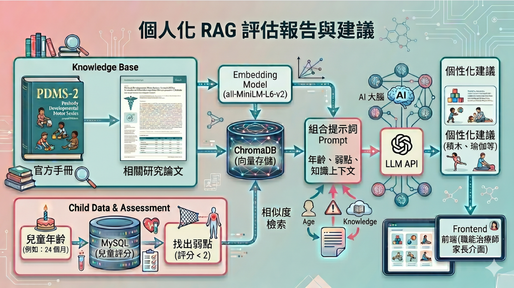

**圖十、個人化 RAG 評估報告架構圖**

## 實作邏輯

目前的部署方式：

- **後端主機：** Flask 與 MySQL 部署在實驗室 Mac mini，外部連線透過 Tailscale 轉成可訪問的位址。
- **媒體存取：** 圖片與影片不直接讀取本機路徑，由後端產生簽名連結，前端可直接透過對外網址開啟對應檔案。

## 使用情境

### 幼兒園與社區活動

老師可以在課堂上安排孩子輪流進入妙妙屋，聽故事、跟著關卡冒險，做出畫線、疊積木、拿取小物件等動作。屋子旁掛著的實體工具會在故事的某些橋段用到，孩子自然動手操作，這些動作就是測驗內容。系統會把孩子的表現完整記錄下來，不需要專門的老師，也不用花太多心力，大人就能拿到一份簡單的結果。課後輔導班或社區活動中心也能用同樣方式進行。

### 偏鄉巡迴與遠端複核

1. 臨床人員或社工帶著「妙妙屋」到偏鄉衛生所或活動中心，5 分鐘內組裝好，確認網路連線後就能開始。
2. 教保員、社工或家長（不需要醫療背景）依照觸控螢幕上的故事引導，帶小朋友完成「豆豆裝罐」「摺紙」等任務。小朋友不用戴任何裝置，只有攝影機在旁邊拍。
3. 現場的筆電只負責擷取影像，影像經網路傳回實驗室的後端伺服器，由 YOLO 與 SAM 完成動作分析。
4. 後端產出初篩報告並存到雲端，都會區醫院的專科醫師調閱後就能遠端複核；判定有遲緩風險的孩子，可以馬上安排後續介入。

### 都會醫院候診分流（擴展場域）

都會區早療門診的通報量大，也可以用這套系統分流。初診兒童在候診時先進「妙妙屋」快篩，醫師看診前就有一份 AI 量化數據可以參考，比較快排除誤報的個案，把門診時間留給真正需要的孩子。

### 實地驗證

2026/5/9 系統已於社區關懷據點（伊甸基金會）進行真實場域測試（教育部大學社會責任實踐計畫「在地扎根．社會共生－優質教育、代間共融、AI 智慧療育計畫」，長庚科技大學主辦），實際讓小朋友操作測驗設備，並留下落地驗證紀錄。

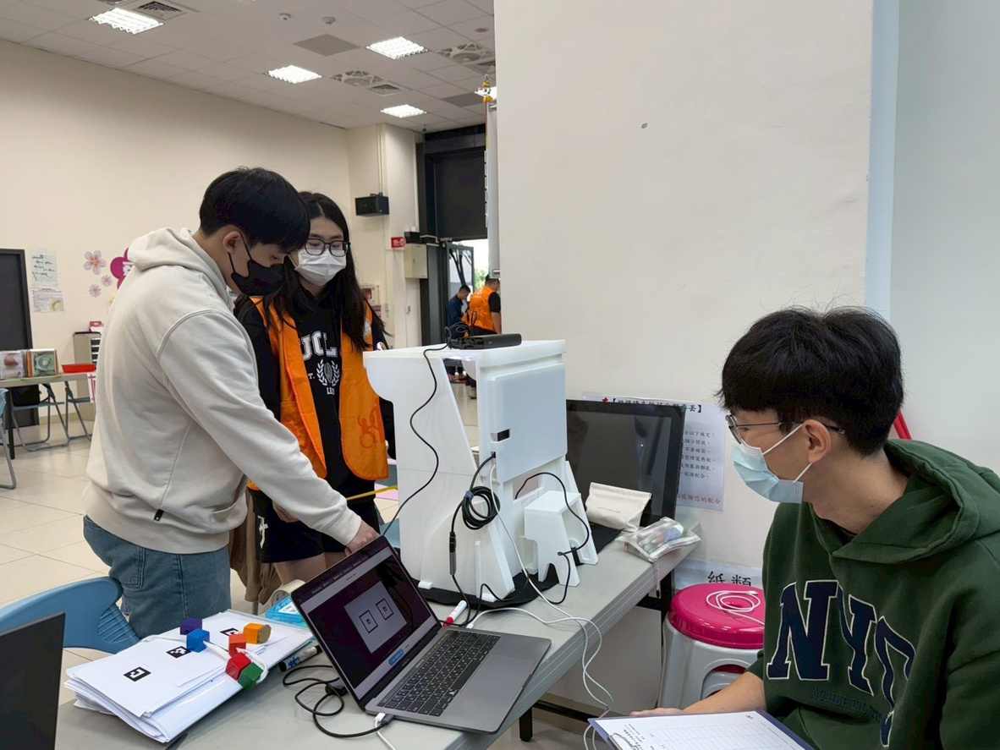

**圖十一、落地測試（設備架設）**

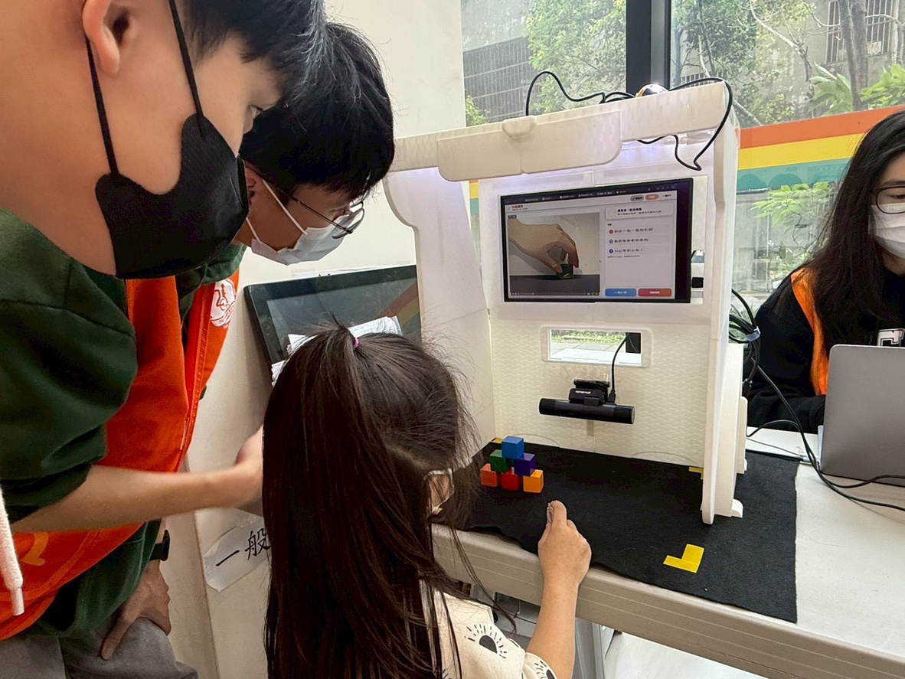

**圖十二、落地測試（小朋友實際操作）**

## 商業模式

少子化之下，兒童發展受到更多關注，早期療育的需求也逐年增加，但偏鄉的精細動作檢查與追蹤仍不容易做。Hsieh 等人[6]發現「家庭訪視式早療方案」能改善偏鄉資源不足的問題，代表把檢測與輔助工具帶到當地是可行的。本系統定位為「偏鄉早期篩檢輔助工具」，測驗結果以數位方式保存，可作為後續兒童發展追蹤的客觀依據，也降低因資源不足而漏測的機率。

### 目標市場

主要客戶是政府公衛體系（B2G）與基層醫療院所（B2B）。衛福部自 2024 年 7 月起為未滿 7 歲兒童新增 6 次發展篩檢[8]，篩檢需求會跟著增加。目標場域有四類：

1. 偏鄉及離島衛生所、社區據點：主要的導入場域，以巡迴方式服務原本沒有評估管道的兒童。
2. 地方醫院與早療機構：當作 AI 輔助初篩工具，先篩掉明顯正常的個案，讓職能治療師把人力用在需要深入評估的兒童。
3. 幼兒園與教育現場：給老師一套標準化的觀察與紀錄方式，非醫療人員也能及早發現異常、啟動轉介。
4. 地方政府與採購單位：由縣市政府、衛生局或基金會採購，經費來自公共衛生預算或 USR、社會創新計畫。

### 收費模式與成本結構

收費分兩部分：一次性的硬體建置費，加上定期收取的訂閱費（包含雲端運算、AI 模型更新、資料儲存與技術支援）。AI 運算和資料都放在共用伺服器，各據點只需要輕量的前端設備，據點越多，每個據點分攤的伺服器成本越低。

| 單一據點硬體（一次性） | 金額（新台幣） | 說明 |
| --- | --- | --- |
| 文書筆電 | 5,000 元 | 邊緣終端，僅需支援鏡頭擷取與網頁運算 |
| 3D 列印隔板 | 500 元 | |
| 觸控螢幕 | 3,000 元 | |
| 雙鏡頭攝影機 | 1,000 元 | |
| PDMS-2 標準化教具組 | 30,000 元 | 依量表規格採購之官方教具，可長期重複使用 |
| **單一據點合計** | **39,500 元** | |
| 共用雲端運算伺服器（建議規格 Mac mini M4） | 26,900 元 | 所有據點共用；現行部署為 Mac mini M2 Pro |

### 產品定位與法規

本系統是初步健康篩檢與衛教輔助工具，不是醫療器材。它只提供兒童動作表現的量化數據與風險提示，不做診斷，也不給治療建議，性質跟體重計、體溫計類似：量測結果超出常態時，提醒使用者去找專業評估，要不要轉介、怎麼處置，由醫師或職能治療師決定。如果之後加入具體的診斷建議或治療指引，就可能被歸類為醫療器材軟體（SaMD），需要另外申請認證。

## 競爭分析

市面上與本作品定位最相近者為馬偕兒童醫院與台北科技大學合作開發之「ONE 線上兒童發展智慧評估系統」[15][16]，兩者皆聚焦早期療育初步評估，但技術路徑與定位不同：

| 比較項目 | 本系統 | ONE 系統 |
| --- | --- | --- |
| 主要功能定位 | 初步發展情況推測、精細動作評估 | 智能個別化評估、發展年齡推測 |
| 核心評估面向 | 著重精細動作 | 涵蓋六大發展核心能力 |
| 施測方式 | 實際操作場地與道具，含引導動畫可獨立操作 | 純線上評測，不需特殊工具或醫療人員 |
| 年齡範圍 | 3～6 歲 | 0～6 歲 |
| 數據輸出 | 完整資料介面，供醫護人員與家長查詢 | 發展年齡、六角圖分析、長期追蹤進程 |
| 收費方式 | 硬體建置費＋訂閱制，成本結構透明 | 未公開定價，採個案洽詢報價 |

本系統的長處在實際操作。小朋友用標準化教具完成任務，比較不受居家環境或家長代答影響；場地、教具、AI 評分和資料庫也都在同一套系統裡。另外，系統只做 3～6 歲精細動作，可以做得比較細。

短處是評估面向和年齡範圍都比較窄，而且需要實體場地和教具，沒辦法像純線上工具一樣在家隨時施測。輸出的是分數或風險分級，不像發展年齡那麼好懂；臨床實證數據也還在累積。

外部條件上，合作醫院的職能治療師團隊長期使用 PDMS-2，可以協助驗證，醫院的早療門診網絡也能當推廣場域。單一據點成本低，容易量產，AI 評分演算法和教具設計也有機會申請專利。

兩套系統比較像互補：ONE 系統適合大規模、輕量的初步篩檢；本系統適合偏鄉巡迴，以及需要實際操作、量化數據較可靠的深入篩檢。

## 預期成果

### 1. 老師面向

I. 減少依賴經驗判斷，透過「妙妙屋」故事情境中任務，快速獲得具客觀依據的孩童精細動作表現紀錄。

II. 不需專業職能治療背景即可操作，節省時間且提升判斷準確度。

### 2. 家長面向

I. 每項動作均有系統記錄，避免只用模糊「發展遲緩可能」警示，提高家長信任，促進及早就醫。

II. 降低家長焦慮，因數據佐證取代猜測。

### 3. 孩童體驗

I. 以故事化的遊戲化方式進行篩檢，減少測驗壓力，提升參與度與自然表現。

II. 小朋友在趣味任務中完成測驗內容，如「疊魔法石頭」、「用魔法畫筆完成線條」，表現更真實可靠。

### 4. 學校管理

I. 累積標準化量表指標與影音紀錄摘要，建立完整發展史。

II. 新任老師能無縫銜接孩子追蹤狀況，省去重新觀察時間。

III. 方便對照療育成效，支持專業人員掌握進度。

### 5. 長期影響

I. 減少偏鄉兒童發展遲緩案件數因延誤而惡化的情況。

II. 促使提早發現、提早轉介，增加孩童接受適時療育機會。

III. 幫助孩童將來課堂進度正常化，提升生活自理能力。

IV. 減輕老師因缺乏專業資源的無力感，提供可依賴工具。

V. 提升家長安心感，確保偏鄉兒童不因地理限制錯失協助。

### 6. 未來規劃

初步規劃導入 LINE Bot 銜接後續轉介流程：測驗結果低於標準者，由 LINE Bot 通知專業職能治療師進行線上複核，再將複核結果回傳家長，家長可自行聯絡醫院進一步治療。

### 7. 開發時程與里程碑

- **已完成：** 17 項任務之 AI 判讀模型開發、全任務語音口白與情境動畫內容製作、四級權限與後台管理系統建置、社區關懷據點實地測試（2026 年 5 月 9 日）。
- **進行中：** 合作醫院收案與資料蒐集、個資保護與資安機制強化、RAG 決策層功能與職能治療師需求確認。
- **未來 12 個月：** 完成與職能治療師之臨床評分比對驗證、擴及至少 3 處偏鄉衛生所或社區關懷據點巡迴試辦、持續優化模型準確度並評估擴充評量年齡層之可行性。

## 安裝與使用指南

### 系統需求

#### 硬體需求

- **前端：** 一般文書筆電，Intel i5 或同等級以上
- **記憶體：** 8GB RAM 以上
- **儲存空間：** 10GB 可用空間
- **攝影機：** PW313D 雙鏡頭網路攝影機或相容裝置（俯視＋側面雙視角，分別對應專用偵測模型）
- **顯示器：** 觸控螢幕 (Anmite 14 吋 IPS 1080P-60Hz)
- **施測環境：** 「妙妙屋」拱形可組裝隔板結構、統一施測環境測驗墊、光源燈條
- **Ch5 專用：** Arduino 搭配荷重元（load cell）感測模組
- **後端伺服器：** Mac mini M2 Pro，透過 Tailscale 建立跨網域安全連線

#### 軟體需求

- **作業系統：** Windows 11（前端）、macOS（後端 Mac mini）
- **Python 版本：** 3.7/3.10/3.13
- **資料庫：** MySQL 8.0+
- **瀏覽器：** Chrome/Edge (支援觸控功能)

#### 系統規格

- 介面操作回應時間 ≤ 2 秒
- 單次任務之影像分析與評分生成時間 ≤ 15 秒
- 各測驗項目之 AI 辨識與評分準確率 ≥ 85%
- 全系統設備總重量 ≤ 10kg，架設時間約 5 分鐘
- 完整測驗流程（17 項任務）小朋友實際操作約需 10～15 分鐘
- 支援離線快取，於偏鄉 WiFi/4G 網路環境仍可運作，網路恢復後自動同步

## 開發工具及相關說明

### 核心技術框架

- **機器學習／深度學習：** YOLOv8／YOLO11 物件偵測與分割、SAM2／SAM3、TensorFlow 分類模型、PyTorch
- **影像處理：** OpenCV、PIL、骨架化、輪廓分析、ArUco 校正
- **RAG：** ChromaDB、sentence-transformers（all-MiniLM-L6-v2）
- **Web 框架：** Flask (Python 後端)
- **前端技術：** HTML5、CSS3、JavaScript (ES6+)
- **資料庫：** MySQL 關聯式資料庫
- **資安：** bcrypt 密碼雜湊、Tailscale（WireGuard 協定）傳輸加密
- **感測：** Arduino、荷重元（load cell）

## 參考資料

[1]: Guralnick（2011）, "Why Early Intervention Works: A Systems Perspective. Infants & Young Children," 2011. [Online]. Available: https://journals.lww.com/iycjournal/fulltext/2011/01000/why_early_intervention_works__a_systems.2.aspx.

[2]: C. f. D. C. a. Prevention. "Learn the signs. Act early: Early intervention. ." U.S. Department of Health & Human Services. https://www.cdc.gov/act-early/early-intervention/index.html (accessed.

[3]: 行. 綜合統計處. "國情統計通報." https://ws.dgbas.gov.tw/001/Upload/463/relfile/11150/89262/110%E5%B9%B4%E7%99%BC%E5%B1%95%E9%81%B2%E7%B7%A9%E5%85%92%E7%AB%A5%E6%97%A9%E6%9C%9F%E7%99%82%E8%82%B2%E6%9C%8D%E5%8B%99%E4%BA%BA%E6%95%B81.9%E8%90%AC%E4%BA%BA.pdf (accessed.

[4]: A. Hennigan, Ladd, K., & Wolfe, A. , "The effects of occupational therapy-led fine motor centers on preschoolers' fine motor skills. Journal of Occupational Therapy, Schools, & Early Intervention,," 2021. [Online]. Available: https://eric.ed.gov/?id=EJ1322481.

[5]: L. Barnard-Brak, M. M. Morales-Aleman, K. Tomeny, and R. A. McWilliam, "Rural and Racial/Ethnic Differences in Children Receiving Early Intervention Services," Fam Community Health, vol. 44, no. 1, pp. 52-58, Jan/Mar 2021, doi: 10.1097/FCH.0000000000000285.

[6]: Y. H. Hsieh et al., "Collaborative Home-Visit Program for Young Children With Motor Delays in Rural Taiwan: A Pilot Randomized Controlled Trial," Phys Ther, vol. 100, no. 6, pp. 979-994, Jun 23 2020, doi: 10.1093/ptj/pzaa033.

[7]: M. Rebelo, Serrano, J., Duarte-Mendes, P., Paulo, R., Marinho, D. A., & Martins, J., "Validity and reliability of the Portuguese version of the Peabody Developmental Motor Scales-II in children aged 12 to 48 months.," 2021. [Online]. Available: https://pmc.ncbi.nlm.nih.gov/articles/PMC8623394/

[8]: "7 月 1 日起正式上路 未滿 7 歲兒童新增 6 次「兒童發展篩檢服務」透過接受標準化篩檢工具找出關鍵原因. 衛生福利部最新消息." https://www.mohw.gov.tw/cp-16-79140-1.html (accessed.

[9]: 衛生福利部婦幼健康組. "衛生福利部國民健康署補助地方推動 兒童發展聯合評估中心名單." https://www.hpa.gov.tw/Pages/Detail.aspx?nodeid=1602&pid=548 (accessed.

[10]: 衛生福利部, "我國偏鄉離島地區醫療資源及相關提升計畫執行成效之探討 ", (n.d.). [Online]. Available: https://share.google/yaiUBYD6cQvq4Cahq

[11]: 衛生福利部, "優化偏鄉醫療精進計畫第二期," 2024. [Online]. Available: https://share.google/2wvYmhQ713gsbjvCE

[12]: Y. Y. Choo, P. Agarwal, C. H. How, and S. P. Yeleswarapu, "Developmental delay: identification and management at primary care level," Singapore Med J, vol. 60, no. 3, pp. 119-123, Mar 2019, doi: 10.11622/smedj.2019025.

[13]: 桃園市政府, "桃園市發展遲緩兒童通報概況五年統計."

[14]: "發展遲緩兒通報激增 桃園推「早療診所」一條龍服務," 2024. [Online]. Available: https://general.dale.nthu.edu.tw/?p=12944

[15]: "ONE 線上兒童發展智慧評估系統," Healthcare+ B2B 全球醫療採購網. [Online]. Available: https://www.hst.org.tw/tw/product/solution/322

[16]: "ONE 線上兒童發展智慧評估系統," 國家新創獎（InnoAward）, 2024.
